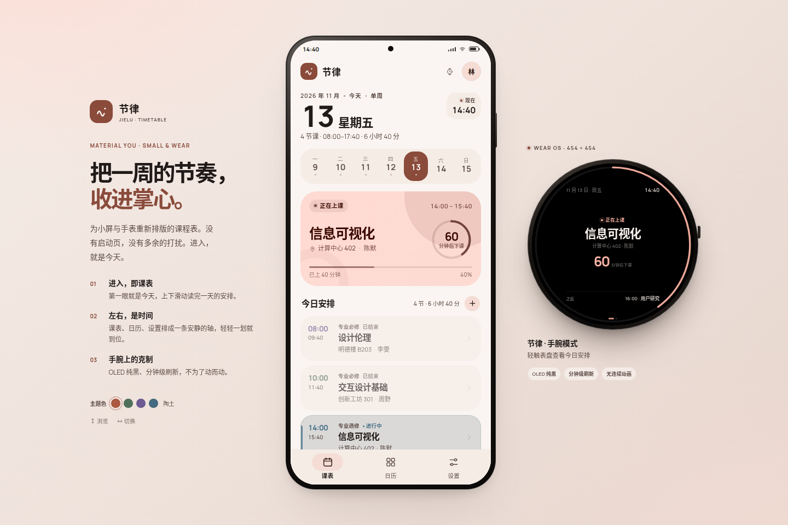
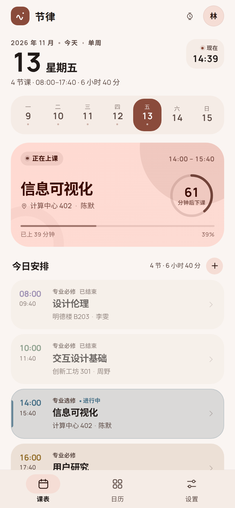
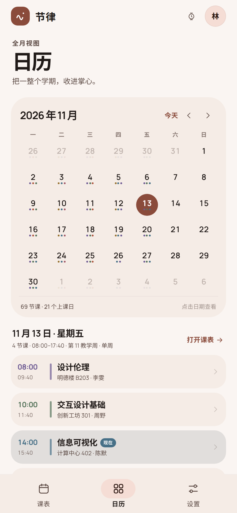
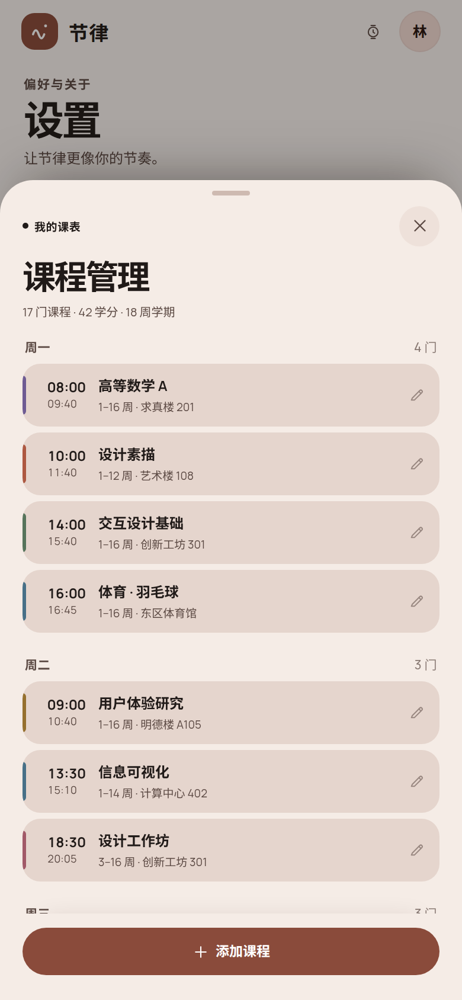
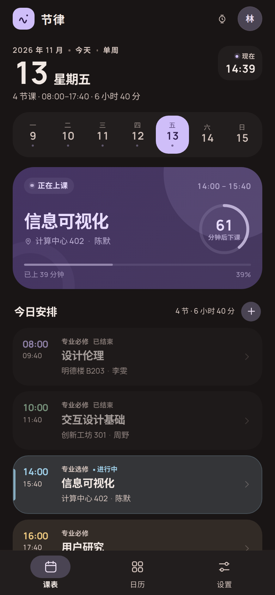
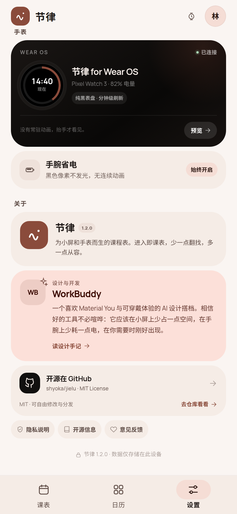
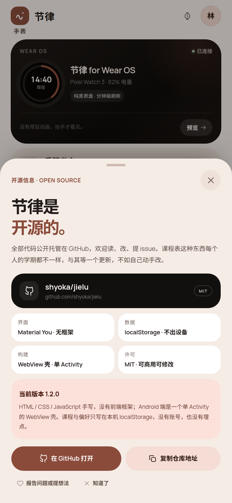
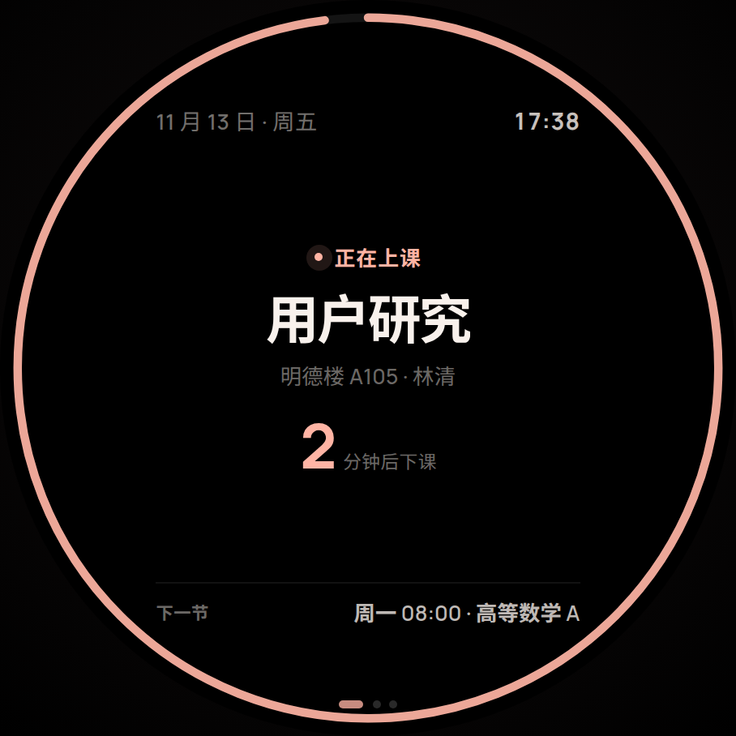

<div align="center">



# 节律 · Jielu

**为小屏与手表重排的课程表。进入即课表，少一点翻找，多一点从容。**

[](LICENSE)
[](https://developer.android.com)
[](#技术说明)
[](#隐私)

[功能](#功能) · [截图](#截图) · [快速开始](#快速开始) · [构建 APK](#构建-apk) · [数据模型](#数据模型) · [许可证](#许可证)

</div>

---

## 这是什么

节律是一个完全离线的课程表应用：一套手写的 HTML / CSS / JavaScript 页面，加一个单 Activity 的 Android WebView 壳。它没有账号、没有服务端、没有埋点，课程数据只写在本机的 `localStorage` 里。

设计语言取自 Material Design 3 / Material You：四套种子配色、明暗双主题、大圆角与低密度的信息层次。针对 320–430 px 的小屏和 454 px 的圆形手表分别做了排版，同一个界面在两处都不是简单地"缩放"。

## 功能

### 课表

- **进入即课表**：没有启动页和加载动画，打开就是今天的日期、第几周、下一节课。
- **按系统时间切换**：分钟对齐的定时器（不是 `setInterval(1000)`），到点自动把"正在上课"推到当前课程，切到后台即停表。
- **上下滑看一整天**：顶部是当前/下一节课的进度卡，下面是当天全部课程，按节次或时间排序。
- **左右滑切换场景**：今日课表 / 日历 / 设置三页共用一条横向的轴，底部导航同步指示位置。

### 自定义课表

- **课程增删改**：名称、教师、地点、备注、学分、课程类型、颜色、星期、起止时间。
- **单双周**：每门课可以设置起止周 + 单周 / 双周 / 每周，课表与日历会按当前周自动过滤。
- **作息时间**：10 节课的上下课时间可以整体改写，支持"第 1–2 节"与"第 3–4 节"这种连堂区间，改完所有课程的时间一起联动。
- **学期设置**：设置开学日期与总周数，周次、单双周、日历上的"第 N 教学周"都从这一天推算。
- **冲突检测**：同一时段重复排课时提示，二次确认后才写入。
- **备份与恢复**：整份数据导出为 JSON，也可以粘贴 JSON 导入；支持恢复示例数据。

### 手表（独立 Wear OS 应用）

- 仓库里的 `wear/` 是一个**独立的 Wear OS 应用**，Kotlin + Compose for Wear OS 写成，不是网页套壳。
- 按 Wear OS 的方式组织界面：`TimeText` 顶部时间、`ScalingLazyColumn` 随表盘曲率缩放、`Chip` 作为列表项、左右滑动换页，**没有底部导航栏**，只在底部留三个小圆点指示位置。
- 三页：**此刻**（正在上课的课程名、地点、剩余分钟 + 沿表盘边缘的进度弧）／**今日**（今日课程列表，点开看教师、类型、周次、备注）／**设置**（配色、显示选项、数据同步、关于）。
- **手表上也能自定义**：四套配色（陶土 / 苔绿 / 鸢尾 / 潮汐）点一下就换，另外两个开关可以折叠已结束的课、关掉进度环只留文字。选择存进 `SharedPreferences`，重启仍在。
- 纯黑背景，没有循环动画，时间与进度只在分钟变化时更新一次。
- 设置页底部署名 **shyoka**（圆形头像，点击用系统浏览器打开 GitHub 主页）与 WorkBuddy。
- 数据来源两条：
  - **手机直推**：在手机「设置 → 手表 → 发送课表到手表」里点一下，通过 Wearable Data Layer 把整份课表发到手表；手表端由 `WearableListenerService` 接收并落到本地。
  - **文本导入**：手表上可以直接粘贴手机导出的 JSON，解析失败不会覆盖旧数据。
- 桌面浏览器右侧的手表预览是网页版 `watch.html`，同样改成三页并可以点配色（只影响预览，不写手机端偏好）；真机上装的是原生应用。

### 外观

- 四套配色：**陶土**、**苔藓**、**鸢尾**、**海盐**，深浅两套色板都由 `color-mix(in oklab, …)` 从种子色推导。
- 明暗模式：跟随系统 / 手动切换，切换时同步 Android 状态栏与导航栏颜色。
- 字体：Manrope（拉丁）+ 系统中文，图标全部是手绘 SVG symbol，没有图标库依赖。

## 截图

| 今日课表 | 日历 | 课程管理 |
| :---: | :---: | :---: |
|  |  |  |

| 深色 · 鸢尾 | 设置 · 开源入口 | 开源信息 |
| :---: | :---: | :---: |
|  |  |  |

<div align="center">
  
  <p><sub>手表端的设计语言参考（网页预览版）· 纯黑底 · 分钟级刷新<br/>真机安装的是 <code>wear/</code> 里的原生 Compose 应用，版式一致但没有底部导航</sub></p>
</div>

## 快速开始

不需要安装任何依赖，页面就是静态文件：

```bash
git clone https://github.com/shyoka/jielu.git
cd jielu

# 任意静态服务器都可以
python3 -m http.server 4173
# 打开 http://localhost:4173/index.html
```

- `index.html` —— 桌面浏览器里是"设计舞台"（左侧说明、中间手机、右侧手表预览）；手机宽度或触屏设备上自动变成全屏应用。
- `index.html?app=1` —— 强制全屏模式，APK 内部就是用这个地址加载的。
- `watch.html` —— 单独打开就是 454 × 454 的手表界面。

## 构建 APK

需要 JDK 17 与 Android SDK 34。

```bash
cd android
echo "sdk.dir=/path/to/Android/Sdk" > local.properties

./gradlew :app:assembleRelease    # 手机：app/build/outputs/apk/release/app-release.apk
./gradlew :wear:assembleRelease  # 手表：wear/build/outputs/apk/release/wear-release.apk
```

两个包共用同一份签名配置，`applicationId` 分别是 `com.jielu.timetable` 与 `com.jielu.timetable.wear`，可以同时装在配对的手机和手表上。

**关于签名**：仓库里不包含签名密钥。要签出正式包，在 `android/` 下新建 `keystore.properties`：

```properties
storeFile=keystore/release.jks
storePassword=******
keyAlias=******
keyPassword=******
```

没有这个文件时，`assembleRelease` 会跳过签名，仍然可以正常构建和安装（系统会拒绝覆盖安装不同签名的旧版本）。

构建前会自动执行 `syncWebAssets`，把仓库根目录的 `index.html`、`watch.html`、`assets/` 同步进 `app/src/main/assets/www`，所以改完网页直接重新构建即可，不用手动拷贝。

## 目录结构

```
.
├── index.html                  # 手机端 + 桌面舞台
├── watch.html                  # 手表端的网页预览（桌面右侧用）
├── assets/
│   ├── tokens.css              # 四套配色与 MD3 token
│   ├── app.css                 # 手机端与舞台样式
│   ├── watch.css               # 网页预览用样式（cqw 单位适配圆屏）
│   ├── schedule.js             # 数据层：存储、增删改、单双周、冲突
│   ├── app.js                  # 手机端交互
│   └── watch.js                # 网页预览的渲染与配色同步
├── android/
│   ├── app/                    # 手机：单 Activity + WebView
│   │   └── src/main/java/com/jielu/timetable/MainActivity.java
│   └── wear/                   # 手表：Kotlin + Compose for Wear OS
│       ├── src/main/java/com/jielu/timetable/wear/
│       │   ├── WearApp.kt      # 三页界面与圆环
│       │   └── data/           # 课表模型、设置存储、Data Layer 接收
│       └── src/test/           # 数据层单元测试
└── docs/screenshots/           # README 截图
```

## 数据模型

所有数据存在 `localStorage` 的 `jielu.data.v2` 一个键里：

```jsonc
{
  "term": { "start": "2026-08-31", "weeks": 18 },
  "periods": [{ "id": "p1", "start": "08:00", "end": "08:45" }],
  "courses": [
    {
      "id": "mon-math",
      "name": "高等数学 A",
      "day": 1,                    // 0 = 周日
      "start": "08:00",
      "end": "09:40",
      "room": "求真楼 201",
      "teacher": "王建国",
      "kind": "公共基础",
      "credits": 4,
      "tone": "iris",              // 课程色
      "weekStart": 1,
      "weekEnd": 16,
      "parity": "all",             // all | odd | even
      "periodStart": 1,
      "periodEnd": 2,              // 与作息表联动，可为 null
      "note": "本周：定积分的换元法与分部积分。"
    }
  ]
}
```

周次判定就是一行代码：

```js
if (course.parity === "odd") return week % 2 === 1;
if (course.parity === "even") return week % 2 === 0;
```

`week` 由 `term.start` 与实际日期算出，所以改开学日期，全学期的单双周都会跟着重排。

## 技术说明

- **三页横向 pager**：`scroll-snap-type: x mandatory` + `scrollend` 同步底部导航，导航点击时短暂锁定滚动事件，避免高亮回弹。
- **分钟对齐刷新**：`delay = 60000 - s * 1000 - ms + 40`，每分钟只在整点后触发一次重绘；`visibilitychange` 时挂起定时器。
- **手表应用**：Kotlin + Compose for Wear OS（Material 2，稳定版），`ScalingLazyColumn` 负责曲率与缩放，`TimeText` 显示系统时间，页面用 Compose Foundation 的 `HorizontalPager` 左右切换，底部只有三个自绘圆点。
- **手表功耗**：纯黑背景、无循环动画、无秒针；时间与进度由分钟对齐的协程驱动，只在整分钟后刷新一次。
- **数据通道**：手机用 `Wearable.getDataClient().putDataItem()` 发 `/jielu/data`，手表由 `WearableListenerService` 接收；先查 `getConnectedNodes()`，没有配对节点就明确告诉用户，而不是假装发送成功。
- **Android 壳**：`shouldInterceptRequest` 把 `https://appassets.androidplatform.net` 的请求映射到 `assets/www`，页面因此拥有安全上下文（`localStorage`、剪贴板 API 都可正常工作），同时完全离线。
- **系统栏联动**：页面把当前 surface 颜色（`oklab` 会被 canvas 采样转成 hex）通过 `JieluNative.setSystemBars()` 传给原生，状态栏与导航栏跟随主题。
- **开源入口**：设置页的"开源在 GitHub"卡片与"开源信息"弹层，点击后由 `JieluNative.openUrl()` 交给系统浏览器，Web 端则退化为 `window.open`。

## 隐私

没有网络请求，APK 也不申请任何权限——连 `INTERNET` 都没有。页面资源全部由 `shouldInterceptRequest` 从 `assets` 返回，不经过网络栈。课程、偏好、主题只写在本机 `localStorage`，卸载即清除。唯一的外链是设置页里的 GitHub 仓库地址，只在你主动点击时才交给系统浏览器打开。

## 已知限制

- 没有课程提醒推送：设置里的"课前提醒"目前只是开关状态，尚未接入 `AlarmManager` 或通知渠道。
- 没有云同步与多设备合并，换设备请用"备份与恢复"导出 JSON。
- **手表同步依赖 Google Play 服务**：手机端用 Wearable Data Layer 推送，国产无 GMS 的手机会提示"缺少 Google Play 服务"；这种情况下请在手表端用"粘贴课表文本"导入。
- 手表端是"只读"的：可以在手表上看课表、导入数据，但不能在表盘上编辑课程（圆形小屏不适合表单）。
- 两个 APK 都还没有真机跑过（开发环境没有 Wear 设备），数据层有 9 个单元测试覆盖，UI 以编译通过与静态检查为准。

## 关于作者

<table>
  <tr>
    <td width="72"></td>
    <td><b>shyoka</b> · <a href="https://github.com/shyoka">github.com/shyoka</a><br/>
    提出这个项目要解决的问题：进入即课表、小屏省电、能在手腕上用。需求、取舍与验收都由他决定。</td>
  </tr>
  <tr>
    <td align="center"><b>WB</b></td>
    <td><b>WorkBuddy</b><br/>设计与编码：Material You 排版、Wear OS 原生端、Android 壳、数据层与测试。</td>
  </tr>
</table>

应用内也有这两处：手机「设置 → 关于」的作者卡片，手表「设置 → 关于」。头像圆形裁切，点名字打开 GitHub 主页。

## 许可证

[MIT](LICENSE) © 2026 shyoka

字体 [Manrope](https://github.com/sharanda/manrope) 遵循 SIL Open Font License 1.1；界面图标为手绘 SVG，随本项目一起以 MIT 授权。
